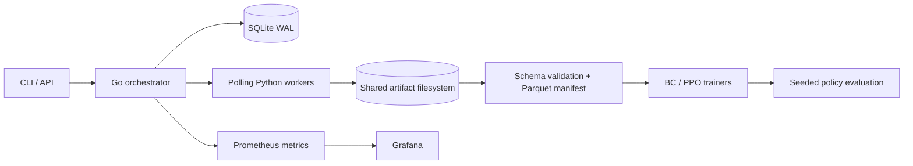

# Robot Fleet Learning Platform

A local, small-scale robotics learning platform for scheduling simulator and learning work, validating trajectory data, and tracking model artifacts. It targets native Apple Silicon CPU execution. It is an engineering prototype, not a production fleet system or sim-to-real stack.

## Architecture



The control plane stores job state and leases in SQLite; the data plane stores Parquet episodes and checkpoints by URI. Shared local storage is simple for one host, but it is not a multi-host storage protocol. Replace artifact URIs with object storage and keep immutable hashes/manifests when scaling beyond one machine. Execution is at least once; attempt-scoped lease tokens fence stale completion commits.

## Quick start

Requirements: Go 1.23+, Python 3.10+, Docker Desktop (optional), and internet access for initial dependency installation.

```bash
make setup
make test
make up
```

The Python worker image installs Gymnasium MuJoCo support and a CPU PyTorch build. On macOS, native MuJoCo can be faster and easier to diagnose than Docker Desktop; install requirements in `.venv`, start the orchestrator with `cd orchestrator && go run ./cmd/server`, and start a worker with `PYTHONPATH=. .venv/bin/python -m workers.simulation.worker`. The worker collection job is deliberately labeled `random-baseline`, not expert data.

In another terminal:

```bash
make demo
curl http://localhost:8080/metrics
```

Prometheus is at `http://localhost:9090`, Grafana at `http://localhost:3000`. The current Compose setup is a local developer profile. It shares `./artifacts` between worker and orchestrator and does not provide host-level isolation, resource quotas, or object storage.

## Current implementation status

Implemented: SQLite-backed job submission and persistence, idempotency conflict checks, queued leases with fencing tokens, worker registration/heartbeat, retry/lease recovery loop, cancellation, Prometheus endpoint, JSON control API, canonical protobuf service contract, MuJoCo collection baseline, episode validation, immutable Parquet dataset publication, BC trainer, single-node PPO trainer, three-seed evaluation helper, scheduling measurement harness, and core unit tests.

Not yet complete: generated protobuf clients and a live gRPC server, resource-aware fair scheduling and bounded queue admission, per-job timeout/cancellation propagation to running worker processes, full per-job training/evaluation dispatch, full dashboard panels, recovery/load/backpressure benchmark suite, and end-to-end integration testing. The worker currently supports actual collection only; unsupported job types return an explicit accepted placeholder result and must not be treated as training/evaluation results. Review `docs/limitations.md` before making capability claims.

## Commands

| Command | Purpose |
|---|---|
| `make setup` | Install Go and Python dependencies |
| `make proto` | Generate Go/Python bindings (requires protoc and plugins) |
| `make test` | Run Go race tests and pytest |
| `make lint` | Go vet and Python bytecode compile |
| `make up` / `make down` | Start/stop local services |
| `make demo` | Submit a two-episode baseline collection job |
| `make benchmark` | Measure basic scheduler API overhead |

## Data and reproducibility

Episodes align `T+1` observations with `T` actions, rewards, and termination flags. The validator checks dimensional consistency, finite values, final endings, duplicate IDs, and return consistency. Dataset manifests contain content hashes, schema/environment versions, provenance, and creation time. Training metadata records dataset path, seed, device, library version, and checkpoint digest. Exact repeatability across operating systems and math backends is not guaranteed.

## Benchmark methodology

`benchmarks/scheduling/run.py` records individual request latencies. Run it at least three times and retain raw output before aggregating; it measures API scheduling overhead only, not simulation throughput or CPU scaling. No benchmark result is included because this workspace did not have dependencies available for a complete run. The full 1/2/4/8 worker scalability, backpressure, worker-kill recovery, and learning comparison protocol remains specified in `docs/benchmarking.md`.

## Why this project

The repository demonstrates robotics infrastructure concerns that sit between simulation and ML: durable scheduling, lease fencing, trajectory schema contracts, immutable data lineage, reproducible training artifacts, and observable services. The current source is an initial, locally testable foundation, not evidence of production deployment, fleet-scale operation, or physical robot validation.

## License

MIT. See [LICENSE](LICENSE).
